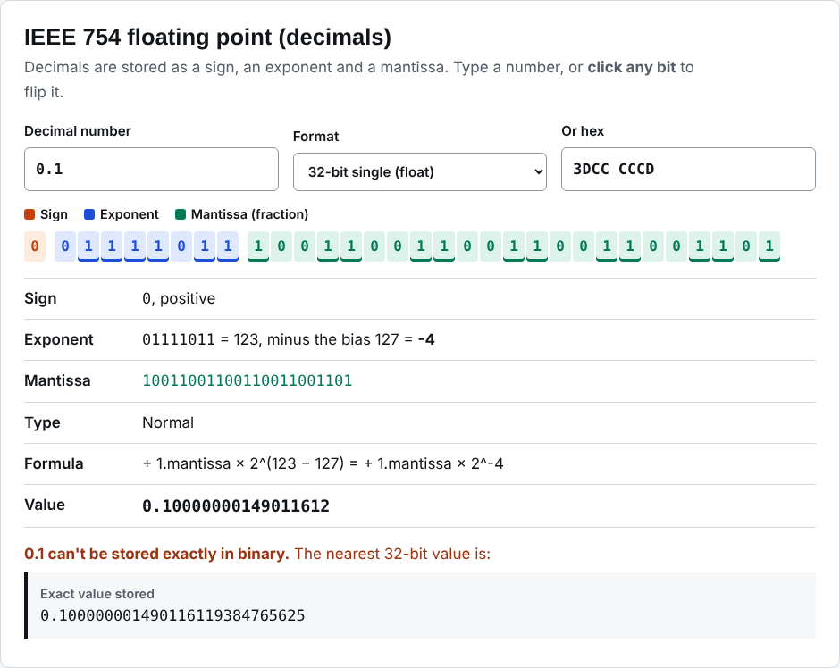

# How computers store numbers

[](https://github.com/macroer16/number-systems-converter/actions/workflows/test.yml)

An interactive tool for converting between number bases, seeing how negative numbers are stored in two's complement, and exploring IEEE 754 floating point bit by bit, including *why* 0.1 can't be stored exactly.

**[Try it live](https://macroer16.github.io/number-systems-converter/)**



## Why I built it

In my Computer Systems Fundamentals module, binary, hex, two's complement and IEEE 754 are easy to follow on paper but hard to *see*. Most online converters just give you an answer. I wanted something that shows the working and lets you change one bit at a time to see what each part does.

## What it does

**Number bases**
- Type in binary, octal, decimal or hex and the other three update instantly.
- Accepts `0b` and `0x` prefixes, spaces and underscores. Binary is shown in groups of 4.
- Shows the repeated-division working for decimal to binary.
- Uses BigInt, so huge numbers convert exactly.

**Two's complement**
- Encodes any whole number in 8, 16, 32 or 64 bits, with the sign bit highlighted.
- Tells you the range for each width and refuses values that don't fit.
- Explains the "flip the bits and add 1" method.

**IEEE 754 floating point**
- 32-bit single and 64-bit double precision.
- Colour-coded **sign**, **exponent** and **mantissa** bits. **Click any bit to flip it** and see the value change.
- Explains the stored exponent, the bias (127 or 1023), the real exponent and the formula used.
- Recognises normal, subnormal, zero, infinity and NaN.
- Shows the **exact decimal value actually stored**, worked out with BigInt maths, so you can see that 0.1 is really 0.100000001490116119384765625 as a float.
- Accepts hex input, e.g. `3F800000` = 1.0.

## How it's built

- **`src/convert.js`**: all the conversion logic as pure functions: BigInt base conversion, two's complement, IEEE 754 encode and decode using `DataView`, and exact decimal expansion.
- **`src/app.js`**: the interactive page.
- Plain JavaScript modules, no build step, hosted on GitHub Pages.

### How the exact value is calculated
A float stores `significand × 2^exponent`. When the exponent is negative, multiplying by 5^k and moving the decimal point k places gives the exact decimal, because 1/2^k = 5^k/10^k. Every binary fraction has a finite decimal expansion, so this is always exact.

## Run it locally

```bash
git clone https://github.com/macroer16/number-systems-converter.git
cd number-systems-converter
python3 -m http.server 8000
# open http://localhost:8000
```

## Tests

```bash
npm test
```

There are 17 tests using standard test values:
- 1.0 = `3F80 0000`, −2.5 = `C020 0000`, 0.1 = `3DCC CCCD` (float) and `3FB9 9999 9999 999A` (double)
- the smallest subnormal
- infinity, NaN and −0
- every 8-bit two's complement value round-trips correctly
- range errors and invalid digits
- the exact stored values of 0.1
- 2²⁴ + 1 is shown as not exact in a float but exact in a double

GitHub Actions runs them on every push.

## Note

This is a learning tool. It isn't a source of coursework answers, and it shows the working so you can learn the method yourself.

## What I learned

_TODO (Victor writes this)_

## Next steps

- [ ] Floating-point addition, showing how rounding errors appear (0.1 + 0.2)
- [ ] Half precision (16-bit) and bfloat16, used in AI hardware
- [ ] Binary fractions: show the working for converting 0.1 to binary

Built by [Victor Benson](https://macroer16.github.io/victor-cloud-portfolio/).
